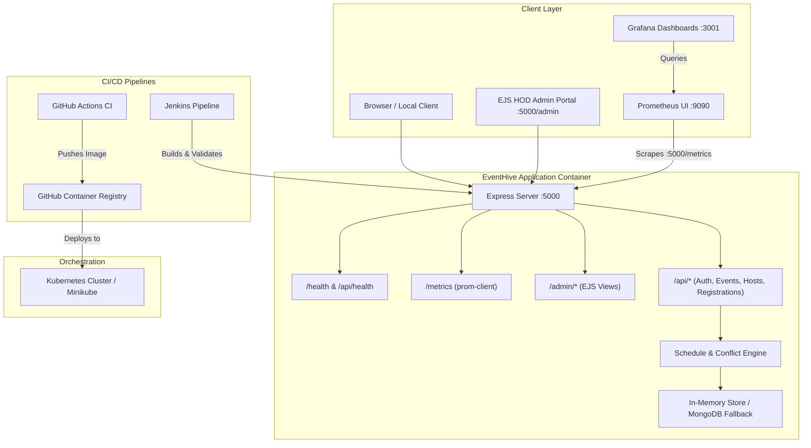

# EVENTHIVE

## Author

| Roll No. | Name | GitHub username |
|---|---|---|
| 24ESKCS027 | Ajay Bairwa | AJAYlodhy |

## Live Deployment

**Live URL:** https://devops-24eskcs027.onrender.com

**Health Check:** https://devops-24eskcs027.onrender.com/health

---

## 1. Project Overview

**EventHive** is a single-college event lifecycle management and governance platform. It orchestrates college-wide event workflows from proposal to registration with a 4-tier approval chain and schedule conflict prevention:

```
Student Proposal  ──▶  Teacher Host Review  ──▶  HOD Final Approval  ──▶  Published Event  ──▶  Student / Guest Registration
```

EventHive features an EJS-powered Head of Department (HOD) & Admin panel, REST APIs for 5 distinct roles (HOD/Admin, Faculty Host, Event Coordinator, Student, and Public Guest), automated venue schedule conflict detection, Prometheus metrics scraping, and a pre-configured Grafana observability dashboard.

---

## 2. Architecture & Workflow



---

## 3. Technology Stack

- **Backend Runtime**: Node.js 24 LTS, Express.js 4
- **Templating / Frontend**: EJS (Embedded JavaScript Templates), Vanilla CSS, HTML5
- **Data Persistence**: Centralized reactive in-memory data store with automatic MongoDB fallback (`mongoose`)
- **Containerization**: Docker, Docker Compose, Alpine Linux
- **Continuous Integration**: GitHub Actions, Jenkins Declarative Pipeline
- **Orchestration**: Kubernetes manifests (Namespace, ConfigMap, Secrets, Deployment, NodePort Service, HPA, Kustomize)
- **Monitoring & Metrics**: Prometheus (`prom-client`), Grafana
- **Testing**: Node.js native test runner (`node:test`, `node:assert`)

---

## 4. Repository Structure

```
EVENTHIVE/
├── .github/
│   └── workflows/
│       └── ci.yml                 # GitHub Actions CI/CD workflow
├── backend/
│   ├── config/db.js               # Database connection & fallback
│   ├── controllers/               # Role-based API controllers
│   ├── middleware/                # JWT auth & role validation
│   ├── models/                    # DataStore and schemas
│   ├── routes/                    # Express API route handlers
│   ├── server.js                  # Backend compatibility bridge
│   └── test/                      # Deep API & workflow tests
├── docs/
│   ├── JENKINS.md                 # Jenkins setup and viva guide
│   └── ORGANIZER_MODULE.md        # Organizer module specifications
├── k8s/
│   ├── namespace.yaml             # Dedicated eventhive namespace
│   ├── configmap.yaml             # Environment configuration
│   ├── secret.yaml                # Secret credentials (demo)
│   ├── secret-example.yaml        # Secret generation template
│   ├── deployment.yaml            # Replicas, probes, securityContext
│   ├── service.yaml               # NodePort service (:30080)
│   ├── hpa.yaml                   # Autoscaling definition
│   └── kustomization.yaml         # Kustomize aggregator
├── monitoring/
│   ├── prometheus/prometheus.yml  # Prometheus scrape configuration
│   └── grafana/                   # Grafana datasource & dashboard
├── public/                        # Static CSS & client JavaScript
├── scripts/
│   └── hygiene.sh                 # Repository hygiene checker
├── src/
│   ├── controllers/               # EJS Admin panel controller
│   ├── data/mockData.js           # Admin data provider
│   ├── middleware/auth.js         # Admin session middleware
│   ├── routes/adminRoutes.js      # Admin dashboard routes
│   └── views/                     # EJS layouts and views
├── test/
│   ├── admin.test.js              # Admin portal authentication tests
│   ├── api.test.js                # Core API & 404 tests
│   ├── health.test.js             # Real HTTP health check tests
│   └── metrics.test.js            # Prometheus /metrics tests
├── .dockerignore                  # Docker build exclusions
├── .env.example                   # Environment configuration template
├── .gitignore                     # Git tracking exclusions
├── Dockerfile                     # Multi-layer non-root Dockerfile
├── docker-compose.yml             # App + Prometheus + Grafana stack
├── Jenkinsfile                    # Cross-platform Jenkins pipeline
├── Makefile                       # Developer automation shortcuts
├── package.json                   # Dependencies and scripts
└── server.js                      # Unified application entry point
```

---

## 5. Local Setup & Running Locally

### Prerequisites
- Node.js 24.x (or 20+ LTS)
- npm 10+
- Git

### Step-by-Step Setup

1. **Clone the repository**:
   ```bash
   git clone https://github.com/skit-devops-2026/devops-24ESKCS027.git
   cd devops-24ESKCS027
   ```

2. **Copy environment variables**:
   ```bash
   cp .env.example .env
   ```

3. **Install dependencies**:
   ```bash
   npm ci
   # or: make install
   ```

4. **Run the application**:
   ```bash
   npm start
   # or: make run
   ```

5. **Access the application**:
   - Web App / Admin Dashboard: [http://localhost:5000](http://localhost:5000)
   - Health Probe: [http://localhost:5000/health](http://localhost:5000/health)
   - Detailed API Health: [http://localhost:5000/api/health](http://localhost:5000/api/health)
   - Prometheus Metrics: [http://localhost:5000/metrics](http://localhost:5000/metrics)

---

## 6. Running Automated Tests

EventHive uses Node.js native test runner with real HTTP integration tests.

Run all automated tests:
```bash
npm test
# or: make test
```

This runs:
- `test/health.test.js`: Real HTTP assertions on `/health` and `/api/health`
- `test/metrics.test.js`: Prometheus `/metrics` format & custom metrics assertions
- `test/admin.test.js`: HOD/Admin portal login, authentication redirects, and session cookies
- `test/api.test.js`: API discovery endpoints (`/api/events`, `/api/hosts`, `/api/notifications`) and 404 handling
- `backend/test/api.test.js`: 22 deep integration tests on organizer features, registrations, and auth
- `backend/test/college_workflow.test.js`: 10 full-chain college governance tests (proposal -> teacher review -> HOD approval -> student registration -> conflict detection)

---

## 7. Docker & Containerization

### Dockerfile Highlights
- Base Image: `node:24-alpine`
- Security: Runs as non-root user (`USER node`)
- Performance: Layer caching for `package.json` and production-only dependencies
- Health Check: Built-in `HEALTHCHECK` with `wget` hitting `/health`

### Build and Run with Docker

1. **Build Docker image**:
   ```bash
   docker build -t eventhive .
   # or: make docker-build
   ```

2. **Run container**:
   ```bash
   docker run -d --name eventhive -p 5000:5000 eventhive
   ```

3. **Verify container health**:
   ```bash
   curl http://localhost:5000/health
   docker ps  # inspect STATUS: (healthy)
   ```

4. **Stop and remove container**:
   ```bash
   docker stop eventhive && docker rm eventhive
   ```

---

## 8. Docker Compose (Full Stack with Observability)

Run EventHive alongside Prometheus and Grafana with one command:

```bash
docker compose up --build
# or: make docker-up
```

### Services Started:

| Service | URL | Credentials | Description |
|---|---|---|---|
| **EventHive** | [http://localhost:5000](http://localhost:5000) | Configure local admin credentials in `.env` | Main web app and APIs |
| **Prometheus** | [http://localhost:9090](http://localhost:9090) | No authentication configured by default | Scrapes EventHive metrics |
| **Grafana** | [http://localhost:3001](http://localhost:3001) | Username: `admin`; password: set `GRAFANA_ADMIN_PASSWORD` in `.env` | Pre-configured EventHive monitoring dashboard |


## 9. GitHub Actions CI/CD

The workflow in `.github/workflows/ci.yml` runs on every push and pull request:

1. **Repository Hygiene**: Runs `scripts/hygiene.sh` (validates author details, placeholders, file sizes, git hygiene).
2. **Build and Test**: Sets up Node 24, runs `make install`, `make test`, and `make build`.
3. **Kubernetes Validation**: Executes `kubectl kustomize k8s/` and client-side dry-run validation.
4. **Containerization & Smoke Test**:
   - Builds Docker image using Buildx.
   - Spins up test container and verifies `/health` returns HTTP 200.
   - On pushes to `main`, publishes container image to GitHub Container Registry (`ghcr.io/skit-devops-2026/devops-24eskcs027`).

---

## 10. Jenkins Pipeline

The `Jenkinsfile` provides a cross-platform (Windows & Linux) CI/CD automation pipeline:

### Pipeline Stages:
1. `Checkout`: Pulls source code from GitHub.
2. `Environment Setup`: Detects OS and logs Node/Docker runtime versions.
3. `Install Dependencies`: Runs `npm ci`.
4. `Run Tests`: Runs `npm test`.
5. `Build`: Runs `npm run build --if-present`.
6. `Docker Build`: Builds `eventhive:${BUILD_NUMBER}`.
7. `Docker Smoke Test`: Launches container on port 5098, curls `/health`, and verifies 200 OK.
8. `Kubernetes Validation`: Validates Kubernetes manifests with `kubectl kustomize k8s/`.
9. `Verification`: Reports overall success and cleans up temporary resources.

Refer to [docs/JENKINS.md](file:///c:/Users/hp/OneDrive/Documents/Hackathon/EVENTHIVE/docs/JENKINS.md) for step-by-step Jenkins web UI configuration.

---

## 11. Kubernetes Deployment

The `k8s/` directory contains complete, production-grade manifests:

### Manifest Overview:
- `k8s/namespace.yaml`: Creates the isolated `eventhive` namespace.
- `k8s/configmap.yaml`: Injects application environment configuration.
- `k8s/secret.yaml`: Supplies authentication tokens and credentials.
- `k8s/deployment.yaml`: 2 replicas, rolling updates, non-root security context, liveness/readiness probes.
- `k8s/service.yaml`: Exposes deployment via NodePort `30080`.
- `k8s/hpa.yaml`: Scales pods automatically between 2 and 5 based on CPU load.
- `k8s/kustomization.yaml`: Bundles all manifests together.

### Deployment Commands:

1. **Validate manifests offline**:
   ```bash
   kubectl kustomize k8s/
   # or: make k8s-validate
   ```

2. **Deploy to cluster** (Minikube, Docker Desktop, or Cloud K8s):
   ```bash
   kubectl apply -k k8s/
   ```

3. **Check rollout status**:
   ```bash
   kubectl get pods -n eventhive
   kubectl get svc -n eventhive
   ```

4. **Access in browser via port-forward**:
   ```bash
   kubectl port-forward service/eventhive-service 5000:5000 -n eventhive
   ```
   Then open [http://localhost:5000](http://localhost:5000).

---

## 12. Monitoring & Metrics

EventHive exposes standard Prometheus metrics at `/metrics` using `prom-client`:

- **Process Metrics**: CPU usage, heap memory, event loop latency, uptime.
- **HTTP Metrics**: Total request count by status code and route (`eventhive_http_requests_total`), request duration histogram (`eventhive_http_request_duration_seconds`).
- **Domain Metrics**: Active events count (`eventhive_events_count`), total registrations (`eventhive_registrations_count`).

View the live Prometheus metrics stream:
```bash
curl http://localhost:5000/metrics
```

---

## 13. Health Checks & Diagnostics

EventHive provides two health check endpoints:

1. **Lightweight Probe (`/health`)**:
   Designed for container orchestrators, Docker healthcheck, and load balancers.
   ```json
   {
     "status": "ok",
     "service": "eventhive",
     "commit": "62460b2",
     "uptime": 124.5,
     "timestamp": "2026-09-18T09:40:00.000Z"
   }
   ```

2. **Full Diagnostic Endpoint (`/api/health`)**:
   Provides active role mappings, governance workflow status, and live counts for events, hosts, users, registrations, and audit logs.

---

## 14. Troubleshooting

- **Port 5000 in use**: Set `PORT=5001 npm start` or terminate the existing process.
- **Missing dependencies**: Run `npm ci` to cleanly install dependencies from `package-lock.json`.
- **Docker Desktop not running**: Launch Docker Desktop from the Start menu before executing Docker commands.
- **Hygiene check fails**: Run `bash scripts/hygiene.sh` locally to see if untracked files or placeholders remain.
- **Kubernetes offline check**: Use `kubectl kustomize k8s/` to validate manifests without requiring a cluster connection.

---

## 15. Live Deployment

- **Public Application:** [https://devops-24eskcs027.onrender.com](https://devops-24eskcs027.onrender.com)
- **Hosting Platform:** Render (Free Tier)
- **Deployment Source:** GitHub repository, branch `main`
- **Health Endpoint:** [https://devops-24eskcs027.onrender.com/health](https://devops-24eskcs027.onrender.com/health)

**Note:** The free Render instance may sleep after inactivity, so the first request can take longer to respond.
